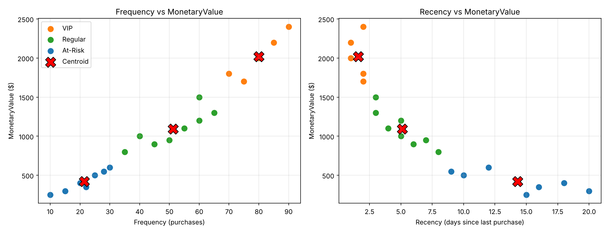
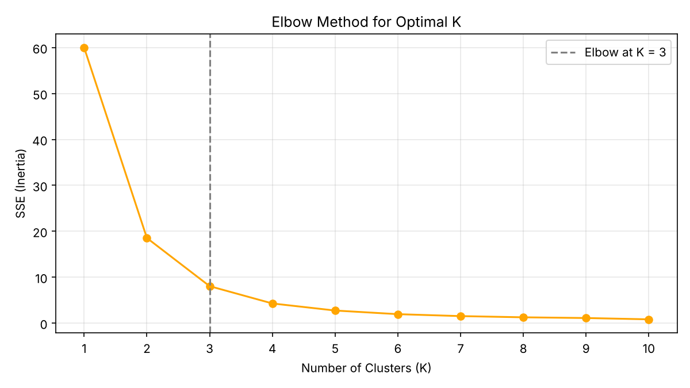

# Customer Segmentation with RFM Analysis and K-Means Clustering

Group customers by purchasing behaviour so that marketing and retention efforts reach the right people.

This project uses **RFM analysis** (Recency, Frequency, Monetary value) and **K-Means clustering** to split a customer base into three actionable segments: **VIP**, **Regular** and **At-Risk**.



---

## Key Results

- The **Elbow Method** identified **3 clusters** as the best fit (SSE: 60.0 → 18.5 → 8.1, then flattening).
- The model was trained **without** the existing segment labels, yet it reproduced them for **19 of 20 customers (95% agreement)**.
- VIP customers make up 25% of the customer base, but their average spend is about **4.8×** that of At-Risk customers.

| Segment | Avg Recency | Avg Frequency | Avg Spend | Customers | Recommended Action |
|---|---|---|---|---|---|
| **VIP** | 1.6 days | 80 | $2,020 | 5 | Loyalty rewards, early access, personal offers |
| **Regular** | 5.1 days | 51 | $1,094 | 8 | Upselling and cross-selling to grow into VIP |
| **At-Risk** | 14.3 days | 21 | $421 | 7 | Win-back campaigns: discounts, reminder emails |

---

## Business Problem

Treating every customer the same wastes marketing budget. High-value customers need to be retained, while customers who are drifting away need to be won back before they leave. This project answers:

1. How many natural customer groups exist in the data?
2. What does each group look like in terms of recency, frequency and spending?
3. What action should the business take for each group?

---

## Dataset

`data/customer_rfm.csv`: a sample dataset of 20 customers.

| Column | Description |
|---|---|
| `CustomerID` | Unique customer identifier |
| `Segment` | Existing segment label (used only to validate the model) |
| `Recency` | Days since the customer's last purchase (lower is better) |
| `Frequency` | Number of purchases (higher is better) |
| `MonetaryValue` | Total amount spent in dollars (higher is better) |

---

## Methodology

1. **Data inspection**: checked structure, data types and missing values (none).
2. **Feature scaling**: standardized the RFM features with `StandardScaler`. K-Means is distance-based, and MonetaryValue ($250–$2,400) would otherwise dominate Recency (1–20 days).
3. **Choosing K**: ran K-Means for K = 1–10 and plotted SSE (inertia). The elbow at K = 3 was confirmed automatically with `KneeLocator`.
4. **Clustering**: trained the final K-Means model with K = 3 and converted the centroids back to original units to profile each segment.
5. **Validation**: compared the clusters with the existing segment labels using a cross-tabulation.
6. **Business translation**: named each segment and recommended a targeted action.



---

## Project Structure

```
customer-segmentation-rfm-kmeans/
├── data/
│   └── customer_rfm.csv              # Input data: RFM values for 20 customers
├── notebooks/
│   └── customer_segmentation_rfm_kmeans.ipynb   # Full analysis, from loading to insights
├── images/
│   ├── elbow_method.png              # SSE vs K chart used to choose the number of clusters
│   └── customer_segments.png         # Scatter plots of the three segments and their centroids
├── outputs/
│   └── customer_segments.csv         # Each customer with their assigned cluster and segment name
├── requirements.txt                  # Python packages needed to run the notebook
├── .gitignore                        # Files Git should not track
└── README.md                         # Project overview (this file)
```

---

## How to Run

```bash
# 1. Clone the repository
git clone https://github.com/FOFOLN6/customer-segmentation-rfm-kmeans.git
cd customer-segmentation-rfm-kmeans

# 2. Install the dependencies
pip install -r requirements.txt

# 3. Open the notebook
jupyter notebook notebooks/customer_segmentation_rfm_kmeans.ipynb
```

Run all cells from top to bottom. The charts are saved to `images/` and the segment assignments to `outputs/customer_segments.csv`.

---

## Tools

Python · pandas · NumPy · scikit-learn · Matplotlib · kneed · Jupyter Notebook

---

## Possible Next Steps

- Apply the same pipeline to a larger, real transaction dataset and calculate RFM directly from raw orders.
- Compare K-Means with other clustering methods such as hierarchical clustering or DBSCAN.
- Use the silhouette score as a second check on the number of clusters.
- Track how customers move between segments over time.

---

## Author

**Liora Lin**
[LinkedIn](https://www.linkedin.com/in/fangfang99) · [GitHub](https://github.com/FOFOLN6)
